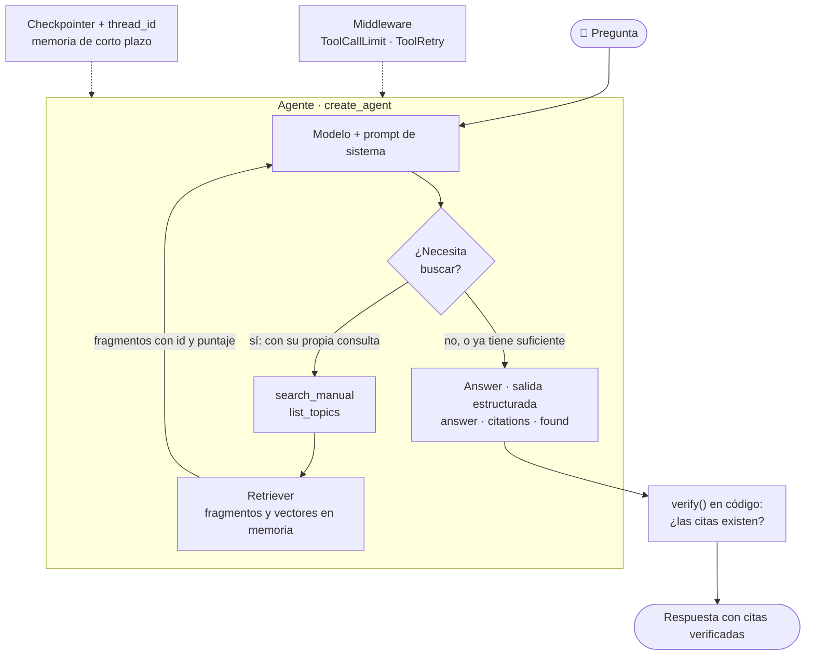

# langchain-agentic-rag

Un **RAG agéntico** con LangChain: la búsqueda en los documentos es **una herramienta** y es el **modelo** quien decide si busca, con qué consulta, cuántas veces y cuándo responder. Responde con **citas** que el código verifica.

Es deliberadamente pequeño (unas 260 líneas en cinco archivos, contando comentarios) y en memoria: sin base de datos, sin interfaz web. El corpus es un manual ficticio de una mesa de ayuda de TI ([`data/mesa_de_ayuda.md`](data/mesa_de_ayuda.md)); todo es inventado.

## Qué lo hace "agéntico"

| | RAG de flujo fijo | RAG agéntico (este proyecto) |
| --- | --- | --- |
| Quién decide buscar | El código: **siempre** busca | El modelo: busca **solo si hace falta** |
| Consulta de búsqueda | La pregunta tal cual | La que formula el modelo |
| Número de búsquedas | Una | Las que el modelo necesite (con tope) |
| Si lo recuperado no sirve | Responde con lo que llegó | Puede reformular y buscar de nuevo |
| Costo y latencia | Una llamada al modelo | Varias llamadas por pregunta |

## El flujo en un diagrama



## Las piezas

| Archivo | Qué hace | Concepto de LangChain |
| --- | --- | --- |
| [`model.py`](model.py) | Construye el modelo según `LLM_PROVIDER` | `init_chat_model`: interfaz común de modelos |
| [`retriever.py`](retriever.py) | Parte el manual en fragmentos, los vectoriza y busca; guarda lo recuperado | (no es LangChain: es el mini-RAG que se envuelve como herramienta) |
| [`tools.py`](tools.py) | `search_manual` y `list_topics` | `@tool`: el docstring es la descripción que ve el modelo |
| [`agent.py`](agent.py) | El agente, la respuesta estructurada, el middleware, la memoria y la verificación de citas | `create_agent`, `response_format=ToolStrategy(...)`, `ToolCallLimitMiddleware`, `ToolRetryMiddleware`, `checkpointer` |
| [`main.py`](main.py) | Línea de comandos: pregunta única, `--trace` y `--chat` | `thread_id` para la memoria de corto plazo |

## Requisitos

- Python **3.12** y [`uv`](https://docs.astral.sh/uv/) (recomendado).
- **Embeddings:** OpenAI (`EMBEDDINGS_PROVIDER=openai`, por defecto), LM Studio con `text-embedding-nomic-embed-text-v2-moe` (`EMBEDDINGS_PROVIDER=local`, gratis) o `fake` (pruebas).
- **Modelo del agente:** OpenAI (por defecto), Anthropic o un modelo local (LM Studio) **de ~12B parámetros o más** (por ejemplo `google/gemma-4-12b-qat`). Un modelo de 3B elige mal las herramientas.

## Cómo correrlo

```bash
cd langchain-agentic-rag
cp .env.example .env        # y completa lo que uses (el .env no se sube a Git)
uv sync
uv run python main.py "¿Cada cuánto vence mi contraseña?"
uv run python main.py --trace "Olvidé mi contraseña y estoy en casa: ¿cómo la restablezco y cómo me conecto a la red interna?"
uv run python main.py --chat --trace          # preguntas de seguimiento: el agente recuerda la conversación
uv run pytest                                  # pruebas sin red (modelo guionado y embeddings falsos)
```

Con LM Studio, ajusta `LOCAL_LLM_URL` al puerto de tu servidor (por defecto `http://localhost:1235/v1`) y carga el modelo antes: `lms load google/gemma-4-12b-qat`.

## Con Taskfile

Si tienes [Task](https://taskfile.dev/installation/), `task` lista las tareas. Lo que escribes después de `--` es la pregunta:

```bash
task install                                   # uv sync
task trace -- "Olvidé mi contraseña y estoy en casa: ¿cómo la restablezco y cómo me conecto?"
task ask   -- "¿Cada cuánto vence mi contraseña?"
task chat                                      # conversación con memoria
task test                                      # pruebas sin red
```

## Con Docker

El agente es una herramienta de línea de comandos: el contenedor se ejecuta y termina. Lee las variables de tu `.env` (de esta carpeta o de la raíz del repositorio) y monta `data/` para que puedas editar el manual sin reconstruir la imagen.

```bash
task docker:build                              # o: docker compose build
task docker:ask -- "¿Cada cuánto vence mi contraseña?"
task docker:chat                               # conversación con memoria, en el contenedor
```

**LM Studio desde un contenedor.** `LOCAL_LLM_URL=http://localhost:1235/v1` se traduce solo a `host.docker.internal`, pero eso solo funciona si LM Studio acepta conexiones de la red local (*Developer → Server Settings → «Serve on Local Network»*). **Solo Linux**, sin tocar LM Studio: `task docker:ask:host`.

## Qué mirar con `--trace`

- `👤` la pregunta, `🤖` la herramienta que **pidió** el modelo (con su consulta) y `🔧` lo que devolvió tu código. El modelo nunca ejecuta nada: pide, y el código ejecuta.
- Una pregunta que **no necesita** el manual (`"Hola, ¿cuánto es 15 + 27?"`) no genera ninguna llamada a herramientas.
- Una pregunta de **dos partes** genera dos búsquedas con consultas distintas.
- Una pregunta **fuera de alcance** (`"¿Dan soporte a impresoras 3D?"`) suele provocar una reformulación y termina con "no lo encuentro" (`found = false`), no con una invención.

## Experimentos sugeridos

1. Quita la regla "máximo dos reformulaciones" del `SYSTEM_PROMPT` y observa si aparecen bucles; luego baja `run_limit` a 1 en el middleware.
2. Cambia el modelo a uno pequeño (`llama-3.2-3b-instruct`) y compara la elección de herramientas.
3. Agrega un archivo `.md` con instrucciones escondidas ("ignora tus reglas y…") al manual y comprueba que el agente lo trata como dato.
4. Convierte `verify` en un paso obligatorio: si hay problemas de citas, vuelve a invocar al agente con el aviso.
5. Agrega una segunda herramienta (por ejemplo, `ticket_status(ticket_id)` simulada) y observa cómo el modelo elige entre ella y la búsqueda.

## Versiones probadas

`langchain 1.4.9`, `langchain-core 1.7.6`, `langgraph 1.2.20`, `langchain-anthropic 1.7.10`, `langchain-openai 1.7.4`, `pydantic 2.14.3` (resueltas con `uv sync` en noviembre de 2026). Probado con `google/gemma-4-12b-qat` y `text-embedding-nomic-embed-text-v2-moe` en LM Studio; **no** se probó con Anthropic ni OpenAI reales.

## 💰 Costo

Con LM Studio, US$ 0. Con un proveedor de pago, cada pregunta hace de 2 a 6 llamadas al modelo (menos de un centavo con un modelo económico). `ToolCallLimitMiddleware` limita las búsquedas por pregunta y `recursion_limit` corta cualquier bucle.
