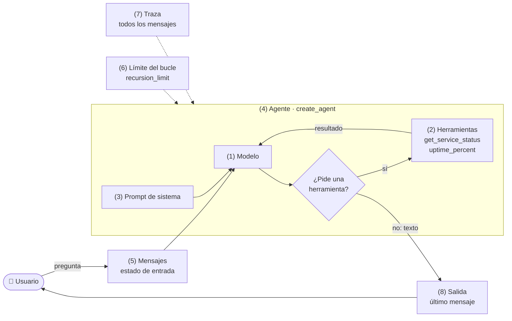
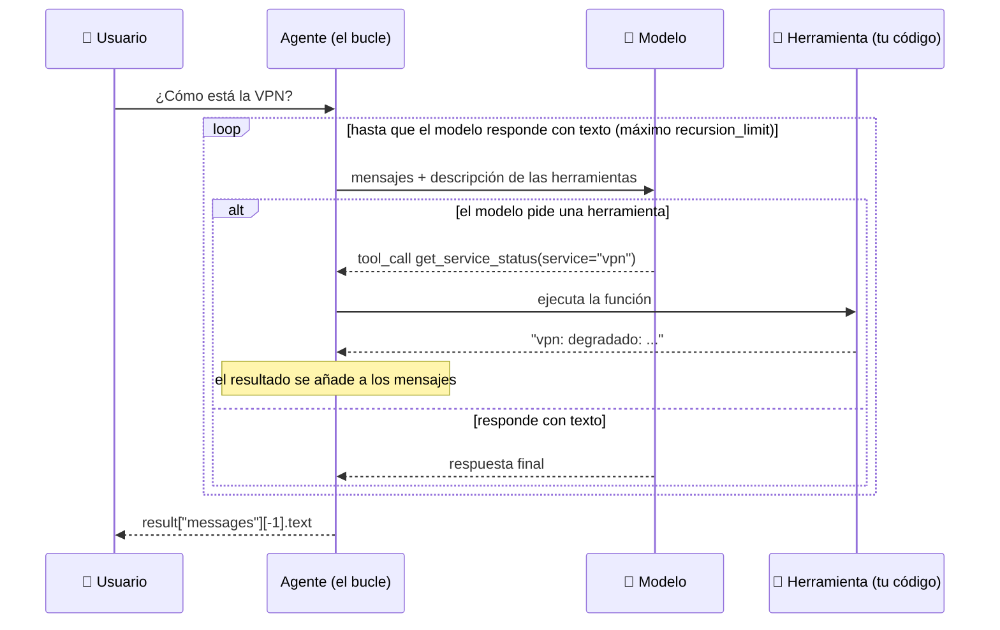

# langchain-basic

Un agente de IA **mínimo** con LangChain. Está hecho para leerse en pantalla: el código principal ([`agent.py`](agent.py)) son unas 25 líneas y cada elemento de un agente aparece **numerado**. No hay infraestructura real: los servicios y sus estados son simulados.

> Un agente es un **modelo** que, en un **bucle**, decide qué **herramientas** usar para responder. Aquí están esas tres piezas, y las demás que hacen falta, a la vista.

## Los 8 elementos

| # | Elemento | Dónde | Qué es | Qué pasa si falta |
| --- | --- | --- | --- | --- |
| 1 | **Modelo** | [`model.py`](model.py) | El LLM que razona y decide. `build_model()` elige proveedor con `LLM_PROVIDER` | Sin modelo no hay quien decida |
| 2 | **Herramientas** | [`tools.py`](tools.py) | Funciones Python decoradas con `@tool`. El modelo lee su **nombre**, su **docstring** y sus **tipos**; nada más | Sin herramientas es un chatbot: solo puede hablar |
| 3 | **Prompt de sistema** | `SYSTEM_PROMPT` en `agent.py` | Instrucciones fijas: rol, reglas y tono | El agente improvisa su rol y puede inventar datos en vez de consultar |
| 4 | **Agente** | `create_agent(...)` | Une modelo + herramientas + prompt y trae **el bucle ya hecho** | Tendrías que escribir el bucle a mano ([`manual_loop.py`](manual_loop.py)) |
| 5 | **Mensajes (estado)** | `{"messages": [...]}` | Entrada y salida: una lista de mensajes. Es la "memoria de trabajo" de esa ejecución | Sin ella el modelo no recibe la pregunta ni el resultado de las herramientas |
| 6 | **Bucle y límite** | `recursion_limit` | El modelo pide una herramienta → el código la ejecuta → el resultado vuelve al modelo → repite hasta que responde con texto. El límite lo corta | Sin límite, un agente confundido puede repetir sin fin (y cobrar cada vuelta) |
| 7 | **Traza** | [`traces.py`](traces.py) | La lista completa de mensajes: 👤 pregunta, 🤖 petición de herramienta, 🔧 resultado, 🤖 respuesta | Sin traza no sabes **por qué** respondió lo que respondió |
| 8 | **Salida** | `result["messages"][-1].text` | El último mensaje es la respuesta final | — |

**El modelo nunca ejecuta nada: solo pide.** Quien ejecuta la función es el código del agente. Por eso el nombre, el docstring y los tipos de una herramienta son, en la práctica, *el prompt de la herramienta*.

## El agente en un diagrama

Los números son los de la tabla de arriba y los de los comentarios de `agent.py`.



Y lo mismo, ordenado en el tiempo, para la pregunta *«¿Cómo está la VPN?»*:



## Requisitos

- [uv](https://docs.astral.sh/uv/) (recomendado; con otro gestor, instala las dependencias de `pyproject.toml`) y Python 3.12.
- Un modelo: **LM Studio** local (gratis), **Anthropic** u **OpenAI** (de pago, centavos). Para ver el bucle sin nada de lo anterior hay un modelo de juguete (`LLM_PROVIDER=fake`).

> **Tamaño del modelo.** Un agente exige más que redactar texto: el modelo debe pedir bien la herramienta, con argumentos válidos. Con un modelo local, usa uno de ≈ 12B de parámetros o más (se probó `google/gemma-4-12b-qat`). Uno de 3B suele elegir mal.

## Ejecutar

```bash
cd langchain-basic
uv sync
cp .env.example .env          # y elige LLM_PROVIDER (por defecto: openai)
```

| Quiero usar | En `.env` | Comando |
| --- | --- | --- |
| LM Studio (servidor local activo y modelo cargado) | `LLM_PROVIDER=local`, `LOCAL_LLM_URL`, `LOCAL_LLM_MODEL` | `uv run python agent.py --trace "¿Cómo está la VPN?"` |
| Anthropic | `LLM_PROVIDER=anthropic`, `ANTHROPIC_API_KEY` | igual |
| OpenAI | `LLM_PROVIDER=openai`, `OPENAI_API_KEY` | igual |
| Nada (modelo de juguete) | `LLM_PROVIDER=fake` | igual |

💰 Con Anthropic u OpenAI, cada pregunta es **2 o 3 llamadas** al modelo (≈ US$ 0.0005 a 0.002 en total con los modelos económicos). Con `local` y `fake`: US$ 0.

Preguntas para probar (`--trace` muestra la traza):

```bash
uv run python agent.py --trace "¿Cómo está la VPN?"                  # usa una herramienta
uv run python agent.py --trace "¿Cuánto es 2 más 2?"                 # no necesita ninguna
uv run python agent.py --trace "¿Cómo está la wiki, y qué disponibilidad tuvo un servicio con 45 minutos caído en 30 días?"   # dos herramientas
uv run python agent.py --trace "¿Cómo está el servidor de impresión?"                  # un servicio que no existe
uv run python manual_loop.py "¿Cómo está la VPN?"                    # el mismo bucle, escrito a mano
```

## Con Taskfile

Si tienes [Task](https://taskfile.dev/installation/), `task` lista las tareas. Lo que escribes después de `--` es la pregunta:

```bash
task install                                   # uv sync
task trace -- "¿Cómo está la wiki?"            # el agente, con la traza
task run   -- "¿Cuánto es 2 más 2?"            # solo la respuesta
task manual                                    # el mismo bucle, escrito a mano
task fake                                      # modelo de juguete: sin API ni LM Studio
```

## Con Docker

El agente es una herramienta de línea de comandos, así que el contenedor se ejecuta y termina (no queda ningún servidor corriendo). Lee las variables de tu `.env` (de esta carpeta o de la raíz del repositorio).

```bash
task docker:build                              # o: docker compose build
task docker:run  -- "¿Cómo está la VPN?"       # o: docker compose run --rm agent --trace "..."
task docker:fake                               # sin nada externo (LLM_PROVIDER=fake)
task docker:manual                             # el bucle a mano, en un contenedor
```

**LM Studio desde un contenedor.** El contenedor no ve tu `localhost`. En Docker, `LOCAL_LLM_URL=http://localhost:1235/v1` se traduce solo a `host.docker.internal`, pero eso solo funciona si LM Studio acepta conexiones de la red local (*Developer → Server Settings → «Serve on Local Network»*). **Solo Linux**, sin tocar LM Studio: `task docker:run:host` (el contenedor comparte la red de tu máquina).

## Leer la traza

```
👤 Human   ¿Cómo está la VPN?
🤖 AI      pide get_service_status({'service': 'vpn'})        ← el modelo PIDE; no ejecuta
🔧 Tool    get_service_status → vpn: degradado: ...           ← el código EJECUTÓ y devolvió el resultado
🤖 AI      La VPN está degradada debido a ...                 ← el modelo responde con texto: fin del bucle
(2 llamadas al modelo en total)
```

- Cada **vuelta** del bucle es una llamada al modelo. Aquí hubo 2: una para pedir la herramienta y otra para redactar con su resultado.
- Si el modelo pide **varias herramientas a la vez** (llamadas en paralelo), verás varios "pide" seguidos y luego sus resultados.
- Si responde **sin** pedir nada, el bucle termina en la primera vuelta.

## El límite del bucle

`config={"recursion_limit": 8}` cuenta pasos del grafo interno: cada llamada al modelo y cada ejecución de herramientas suman uno. Con 8 caben unas **4 vueltas** del modelo. Al toparlo, LangChain lanza `GraphRecursionError`; `agent.py` lo captura y termina con un mensaje. El límite protege tu **dinero y tu tiempo** frente a un agente que se repite.

## Qué cambiar para experimentar

1. Haz vago el docstring de `get_service_status` (borra "Servicios válidos…") y pregunta por la VPN: ¿sigue eligiendo bien?
2. Cambia `SYSTEM_PROMPT` a "Responde siempre en inglés" o quita "no inventes datos" y pregunta por un servicio que no existe.
3. Baja `recursion_limit` a 2 y haz la pregunta de dos herramientas: ¿qué pasa?
4. Añade una tercera herramienta (por ejemplo, `restart_service`) y pregúntate qué riesgos trae una herramienta que **modifica** algo.
5. Compara `agent.py` con `manual_loop.py`: ¿qué hace `create_agent` que el bucle a mano no hace?

## Archivos

| Archivo | Para qué |
| --- | --- |
| `agent.py` | El agente, con los elementos 1 a 8 numerados |
| `model.py` | `build_model()`: elige el modelo según `LLM_PROVIDER` |
| `tools.py` | Las dos herramientas simuladas |
| `traces.py` | `print_trace()`: imprime la conversación de forma legible |
| `manual_loop.py` | El mismo bucle escrito a mano, para ver qué hace `create_agent` |
| `fake_model.py` | Modelo de juguete (sin red) para ver el bucle sin gastar |
| `.env.example` | Variables de entorno |
| `Taskfile.yml` | Tareas: instalar, correr, traza, bucle a mano, modelo de juguete y las de Docker |
| `Dockerfile`, `docker-compose.yml`, `docker-compose.host.yml` | El agente en un contenedor; el segundo archivo (solo Linux) usa la red de tu máquina para alcanzar LM Studio |

## Versiones probadas

`langchain 1.4.9`, `langchain-core 1.7.6`, `langgraph 1.2.20`, `langchain-anthropic 1.7.10`, `langchain-openai 1.7.4`, Python 3.12. LangChain 1.x reemplazó interfaces antiguas (`AgentExecutor`, `initialize_agent`, `LLMChain`): si un tutorial las usa, es anterior a la versión actual; hoy se usa `create_agent`.
