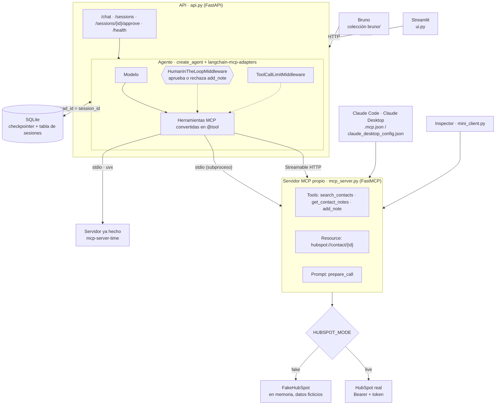

# langchain-mcp-advanced-tooling

Un **servidor MCP propio** (SDK oficial de Python, `FastMCP`) contra **HubSpot CRM** y un **agente de LangChain** que lo consume con `langchain-mcp-adapters`, **solo** o **junto a otro servidor MCP ya hecho** (el de hora). Muestra las tres primitivas de MCP (tools, resources, prompts), los dos transportes (stdio y Streamable HTTP), cómo registrar el servidor en un cliente real (`.mcp.json`) y cómo depurarlo. El agente queda **expuesto con una API (FastAPI)**, con **sesiones persistentes en SQLite**, una **interfaz Streamlit** sencilla y una **colección Bruno** que recorre la API paso a paso.

Es deliberadamente pequeño. Todo funciona **sin cuenta de HubSpot, sin red y sin costo** en modo simulado (`HUBSPOT_MODE=fake`, `LLM_PROVIDER=fake`); los datos son 100 % ficticios.

## Qué expone el servidor y por qué estas piezas

| Primitiva | Nombre | Tipo | Qué hace |
| --- | --- | --- | --- |
| Tool | `search_contacts(query, limit)` | **Lectura** | Busca contactos por nombre, empresa o correo |
| Tool | `get_contact_notes(contact_id, limit)` | **Lectura** | Notas de un contacto |
| Tool | `add_note(contact_id, body)` | **Escritura** | Crea una nota asociada a un contacto |
| Resource (plantilla) | `hubspot://contact/{contact_id}` | Lectura | La ficha de un contacto en Markdown, para dar contexto |
| Prompt | `prepare_call(contact_id)` | — | Plantilla "prepara mi llamada con este contacto" |

**Por qué este conjunto mínimo:** dos lecturas y **una** escritura. Crear una nota es una escritura *aditiva* (no borra nada y se revisa fácil), pero ya obliga a pensar qué pasa cuando el agente **modifica** un sistema real. Un `update_contact` sería la extensión natural.

Los **tipos con restricciones** (`ContactId` con patrón, `Limit` de 1 a 10...) son a la vez el esquema JSON que ve el modelo y la validación que aplica el SDK antes de llamar a la función: un argumento inválido vuelve al modelo como un error legible y puede corregirse. Las **anotaciones** (`readOnlyHint`, `idempotentHint`...) son metadatos descriptivos para el cliente.

## El flujo en un diagrama



## Las piezas

| Archivo | Qué hace | Concepto |
| --- | --- | --- |
| [`mcp_server.py`](mcp_server.py) | El servidor: tools, resource con plantilla de URI y prompt; stdio o HTTP | `FastMCP`, `@mcp.tool(annotations=...)`, `@mcp.resource`, `@mcp.prompt` |
| [`hubspot_client.py`](hubspot_client.py) | `FakeHubSpot` (en memoria) y `LiveHubSpot` (HTTPS con `Bearer`) | Interfaz mínima `CRM` |
| [`settings.py`](settings.py) | Configuración desde el entorno; el token no aparece en `repr` | |
| [`agent.py`](agent.py) | El agente, la aprobación humana antes de `add_note` y el tope de llamadas | `create_agent`, `HumanInTheLoopMiddleware`, `ToolCallLimitMiddleware` |
| [`runtime.py`](runtime.py) | Conexión: en memoria, stdio, HTTP o **dos servidores a la vez** | `MultiServerMCPClient`, `load_mcp_tools`, `tool_name_prefix` |
| [`fake_model.py`](fake_model.py), [`model.py`](model.py) | Modelo guionado (`fake`) y `build_model()` según `LLM_PROVIDER` | `init_chat_model` |
| [`api.py`](api.py) | **La API**: `/chat`, `/sessions`, `/sessions/{id}/approve`, `/health`; modelos Pydantic; SQLite como checkpointer | `FastAPI`, `AsyncSqliteSaver`, `Command(resume=...)` |
| [`ui.py`](ui.py) | Interfaz Streamlit: chat, `session_id` visible, aprobar/rechazar | `st.chat_message`, `st.chat_input` |
| [`bruno/`](bruno) | Colección Bruno: 13 peticiones con aserciones | Cliente HTTP |
| [`main.py`](main.py) | Línea de comandos | |
| [`mini_client.py`](mini_client.py) | Cliente mínimo para explorar y depurar **cualquier** servidor (stdio o HTTP) | `ClientSession`, `stdio_client` |
| [`.mcp.json`](.mcp.json) | Registro del servidor en Claude Code (alcance de proyecto) | Configuración de cliente |

## Requisitos

- Python **3.12** y [`uv`](https://docs.astral.sh/uv/). Docker con `docker compose` (opcional).
- **Modelo del agente:** `fake` (por defecto), OpenAI, Anthropic o un modelo local (LM Studio, **de ~12B parámetros o más**).
- **Modo `--multi`:** necesita `uvx` (viene con uv) e internet la primera vez, para descargar `mcp-server-time`.
- **HubSpot real (opcional):** una cuenta gratuita de pruebas y una Service Key.

## Cómo correrlo (modo simulado)

```bash
cd langchain-mcp-advanced-tooling
cp .env.example .env            # opcional en modo simulado
uv sync
uv run pytest                                                          # pruebas sin red
uv run python main.py --trace "Resume las notas de Luis."              # el agente lanza el servidor por stdio
uv run python main.py --trace "Agrega una nota a Ana: 'Enviar la propuesta el lunes'"   # pregunta antes de escribir
uv run python main.py --multi --trace "¿Qué hora es en America/Guatemala?"   # DOS servidores MCP a la vez
```

Con un modelo real, en `.env`: `LLM_PROVIDER=openai|anthropic|local` y la llave correspondiente. El modelo `fake` solo entiende las tres peticiones de arriba.

## Exponer el agente como API (FastAPI)

**Idea:** el agente es un **servicio sin estado en el proceso**. El historial de cada conversación lo guarda el *checkpointer* (SQLite) bajo un `thread_id`, y el cliente solo lleva el **`session_id`** (que ES ese `thread_id`): mismo id = misma conversación, también **después de reiniciar la API**. Es como un servicio web con sesiones en una base de datos y un cliente que solo conserva la cookie.

```bash
uv sync
LLM_PROVIDER=fake uv run uvicorn api:app --port 8001          # o: task api   ·   documentación interactiva: http://127.0.0.1:8001/docs
```

> Con `LLM_PROVIDER=fake` (modelo guionado) las respuestas son deterministas. Si tu `.env` define otro proveedor, la API usa ese modelo (y cuesta).
> Al arrancar, la API abre **una** sesión MCP con el servidor (lanza `mcp_server.py` por stdio, o usa `MCP_URL` si se define) y descubre las herramientas.

| Método y ruta | Qué hace | Respuestas |
| --- | --- | --- |
| `GET /health` | Estado, proveedor de modelo, modo de HubSpot, servidor MCP y herramientas descubiertas | `200` (`status: ok` o `degraded`) |
| `POST /chat` | Envía un mensaje. Sin `session_id` crea una sesión y **la devuelve**; con uno, continúa esa conversación | `200` · `409` si la sesión espera aprobación · `422` · `503` |
| `POST /sessions/{id}/approve` | Aprueba o rechaza la escritura pendiente (`{"approved": true\|false, "reason": "..."}`) y reanuda al agente | `200` · `404` · `409` si no hay nada pendiente |
| `GET /sessions/{id}` | Historial legible (humano, IA, herramienta), estado y acción pendiente | `200` · `404` |
| `GET /sessions?user_id=` | Sesiones de un usuario | `200` |
| `DELETE /sessions/{id}` | Borra el hilo del checkpointer y la sesión | `204` · `404` |

La respuesta de `/chat` incluye: `session_id`, `user_id`, `status` (`completed` o `awaiting_approval`), `answer`, `tools_used`, `pending_action` (`{tool, args}`) y `usage` (`input_tokens`, `output_tokens`, `model_calls`; sumados sobre el turno).

```bash
# 1) Sesión nueva (la API devuelve el session_id)
curl -s -X POST localhost:8001/chat -H 'content-type: application/json' \
  -d '{"message": "Resume las notas de Luis.", "user_id": "demo"}'
# 2) Seguimiento con el mismo session_id (el agente recuerda a Luis)
curl -s -X POST localhost:8001/chat -H 'content-type: application/json' \
  -d '{"message": "¿Y sus notas?", "session_id": "<id>", "user_id": "demo"}'
# 3) Una escritura pide aprobación: status = awaiting_approval, con la acción propuesta
curl -s -X POST localhost:8001/chat -H 'content-type: application/json' \
  -d '{"message": "Agrega una nota a Ana: '"'"'Enviar la propuesta el lunes'"'"'", "session_id": "mi-sesion"}'
curl -s -X POST localhost:8001/sessions/mi-sesion/approve -H 'content-type: application/json' -d '{"approved": true}'
# 4) Historial y borrado
curl -s localhost:8001/sessions/mi-sesion ; curl -s -X DELETE localhost:8001/sessions/mi-sesion -i
```

**Persistencia:** `SESSIONS_DB` (por defecto `data/sessions.db`) es un archivo SQLite con el historial de las conversaciones (tablas del checkpointer) y la tabla `sessions` (`session_id`, `user_id`, `created_at`). Si no se puede abrir, la API arranca en estado `degraded` y responde **503** con el motivo. Detén la API (Ctrl+C), vuelve a arrancarla y repite `GET /sessions/<id>`: la conversación sigue ahí, **incluida una aprobación pendiente**.

> El CRM simulado y el servidor MCP en modo stdio viven y mueren con la API: tras reiniciarla, las notas de prueba escritas se pierden, pero el **historial de las conversaciones** no.

## Interfaz Streamlit

```bash
LLM_PROVIDER=fake uv run uvicorn api:app --port 8001                      # terminal 1 (o: task api)
API_URL=http://127.0.0.1:8001 uv run streamlit run ui.py --server.port 8510   # terminal 2 (o: task ui)
```

Un chat sencillo que consume la **API por HTTP** (no importa el agente): `user_id` y botón **Nueva sesión** en la barra lateral, el `session_id` visible, un selector para **retomar** una sesión anterior, debajo de cada respuesta las herramientas usadas y los tokens, y, cuando el agente quiere escribir, la acción propuesta con botones **Aprobar** y **Rechazar**.

## Colección Bruno

[Bruno](https://www.usebruno.com/) es un cliente HTTP cuyas colecciones son **archivos de texto** (`.bru`) que viven en el repositorio. La carpeta [`bruno/`](bruno) cuenta una historia en 13 peticiones, cada una con aserciones (y alguna con tests y un script que guarda el `session_id` en una variable):

| # | Petición | Qué enseña |
| --- | --- | --- |
| 01 | Health | La API y las herramientas MCP descubiertas |
| 02 | Chat, sesión nueva | La API **devuelve** el `session_id`; un script lo guarda en `{{session_id}}` |
| 03 | Chat de seguimiento | Mismo `session_id` = memoria ("¿Y sus notas?" sin decir el nombre) |
| 04 | Historial | La conversación vive en el checkpointer. **Reinicia la API y repítela**: sigue ahí |
| 05 | Otra sesión | Sin `session_id` = conversación nueva: no ve la anterior |
| 06 | Listar sesiones | Las dos sesiones del usuario |
| 07 | Escribir pide aprobación | `status: awaiting_approval` y la acción propuesta |
| 08 | Aprobar | `POST /sessions/{id}/approve` con `{"approved": true}` |
| 09 y 10 | Escribir y rechazar | El rechazo no escribe |
| 11 y 12 | Borrar y comprobar | `204` y luego `404` |
| 13 | Validación | `422` con un mensaje vacío |

**Abrirla en Bruno:** *Open Collection* → elige la carpeta `bruno/` → en el selector de ambiente (arriba a la derecha) elige **local** (`baseUrl = http://127.0.0.1:8001`) → ejecuta las peticiones en orden, o *Run* sobre la colección.

**Desde la terminal** (Bruno CLI, con la API corriendo; necesita Node 18 o superior):

```bash
cd bruno && npx @usebruno/cli run --env local          # o: task bruno
```

> Formato `.bru` verificado en `docs.usebruno.com` (bloques `meta`, `post`, `body:json`, `assert`, `script:post-response`, `tests`, `docs`; ambiente en `environments/local.bru`). Bruno recomienda ahora **OpenCollection YAML** para colecciones nuevas; los `.bru` siguen siendo compatibles.

## Explorar y depurar

```bash
uv run python mini_client.py                              # el servidor de referencia mcp-server-time (versión fijada)
uv run python mini_client.py -- uv run python mcp_server.py   # el nuestro: tools, recursos, prompts y una lectura de recurso
npx @modelcontextprotocol/inspector uv run python mcp_server.py   # Inspector (interfaz web): ver "Inspector" abajo
```

- **Logs:** en stdio, `stdout` es el canal del protocolo; un `print()` lo corrompe. Por eso el servidor registra con `logging` a **`stderr`**, que el cliente captura (Claude Desktop los guarda en `mcp-server-<nombre>.log`). En HTTP, `stderr` no llega al cliente: se usan los logs del contenedor (`docker compose logs mcp`) y `curl`.
- **Inspector:** es la interfaz oficial para listar y probar tools, resources y prompts y ver las notificaciones. **No se probó aquí:** la versión `2.15.0` exige Node 22.23 o superior y el equipo de pruebas tiene Node 20.
- **Errores:** una herramienta que falla responde `isError: true` con el mensaje (el modelo puede leerlo y corregirse); un error de protocolo viaja como error JSON-RPC.

## Registrar el servidor en un cliente MCP real

**Claude Code** (CLI). El archivo [`.mcp.json`](.mcp.json) de esta carpeta es la configuración de **alcance de proyecto**; Claude Code te pide aprobarlo antes de usarlo. Equivale a:

```bash
claude mcp add --transport stdio --scope project hubspot -- uv run --directory /ruta/absoluta/langchain-mcp-advanced-tooling python mcp_server.py
claude mcp add --transport http --scope project hubspot-http http://127.0.0.1:8000/mcp     # si el servidor corre por HTTP
claude mcp list
```

**Claude Desktop.** Menú *Settings → Developer → Edit Config* (archivo `claude_desktop_config.json`: macOS `~/Library/Application Support/Claude/`, Windows `%APPDATA%\Claude\`, Linux `~/.config/Claude/`). Usa **rutas absolutas** (el directorio de trabajo no está definido) y reinicia la aplicación por completo:

```json
{
  "mcpServers": {
    "hubspot": {
      "command": "uv",
      "args": ["run", "--directory", "/ruta/absoluta/langchain-mcp-advanced-tooling", "python", "mcp_server.py"],
      "env": { "HUBSPOT_MODE": "fake" }
    }
  }
}
```

Un servidor stdio recibe solo un entorno básico: las variables que necesite (`HUBSPOT_MODE`, `HUBSPOT_TOKEN`) van en `env`.

## Con HubSpot real (modo `live`)

1. En una **cuenta de pruebas** de HubSpot crea una **Service Key** (*Configuración → Integraciones → Service Keys*, o *Desarrollo → Claves*) con los permisos `crm.objects.contacts.read` y, para `add_note`, `crm.objects.contacts.write`.
2. En `.env`: `HUBSPOT_MODE=live` y `HUBSPOT_TOKEN=...` (el `.env` no se sube a Git; el token nunca se imprime).
3. `HUBSPOT_API_VERSION=2026-03` usa las rutas con fecha (`/crm/objects/2026-03/...`); `v3` usa las heredadas (`/crm/v3/objects/...`).
4. Crea contactos de prueba con datos **ficticios**.

> ⚠️ **NO se probó contra una cuenta real de HubSpot** (no había llaves). Lo verificado: las rutas, el formato de la autenticación (`Authorization: Bearer`) y el cuerpo de las peticiones se contrastaron con `developers.hubspot.com` (búsqueda de contactos con `query`/`limit`/`properties`; creación de notas con `hs_timestamp`, `hs_note_body` y asociación de tipo `202` a contacto), y el cliente se prueba con un transporte simulado (`httpx.MockTransport`). **Sin verificar en vivo:** la ruta `.../notes/search` con el filtro `associations.contact`, la lectura de un contacto por id bajo la versión con fecha, los permisos exactos de los endpoints de notas y el comportamiento de una Service Key (en beta pública) en el plan gratuito. Si algo falla, prueba `HUBSPOT_API_VERSION=v3`.

## Con Docker (servidor MCP, API y UI)

```bash
docker compose up --build -d            # o: task docker:up   → tres servicios con healthcheck
```

| Servicio | Qué es | URL |
| --- | --- | --- |
| `mcp` | El servidor MCP por Streamable HTTP | `http://127.0.0.1:8000/mcp` |
| `api` | FastAPI con el agente; usa el servidor `mcp` (`MCP_URL`); SQLite en el volumen `sessions` | `http://127.0.0.1:8001/docs` |
| `ui` | Streamlit; usa la API (`API_URL`) | `http://127.0.0.1:8510` |

```bash
cd bruno && npx @usebruno/cli run --env local          # la colección contra la API del contenedor
docker compose restart api                              # reinicia la API: las sesiones siguen (volumen)
uv run python mini_client.py --url http://127.0.0.1:8000/mcp
docker compose down                                     # con -v también borra las sesiones
```

Por defecto **todo es simulado** (`LLM_PROVIDER=fake`, `HUBSPOT_MODE=fake`): determinista y sin costo. Para usar un modelo o HubSpot reales, ponlos en el `.env` **de esta carpeta**. En Linux, `docker-compose.host.yml` usa la red del anfitrión.

## Pruebas (sin red)

`uv run pytest` ejecuta **38 pruebas** con un modelo guionado y HubSpot simulado:

- **Servidor MCP (12):** las tres herramientas, la validación de argumentos (errores legibles para el modelo), el recurso con plantilla y el prompt.
- **Agente (7):** lectura, escritura con aprobación y con rechazo, error de herramienta con reintento, tope de llamadas y **dos servidores a la vez** con nombres con prefijo.
- **API (11), con `TestClient`:** sesión nueva, continuación con el mismo `session_id`, aislamiento entre sesiones, historial y listado, `404`/`422`, borrado, escritura con aprobación y con rechazo (`409` si se intenta seguir sin resolverla), **persistencia tras "reiniciar" la aplicación** (incluida una aprobación pendiente) y `503` cuando no se puede abrir la base.
- **UI (3), con `streamlit.testing.v1.AppTest`:** chat con `session_id` y herramientas, memoria y nueva sesión, botones Aprobar y Rechazar.
- **Configuración y cliente de HubSpot (5)**, con un transporte simulado.

## Experimentos sugeridos

- Pregunta con `--multi`: "¿Qué hora es en America/Guatemala?" y mira en la traza el prefijo de cada herramienta (`hubspot_...`, `time_...`).
- Registra el servidor en Claude Code (`claude mcp add ...`) y pídele "busca a Ana en el CRM".
- Añade un `update_contact_stage` con un tipo `Literal["lead", "opportunity", "customer"]` y anótala bien.
- Añade un segundo recurso (por ejemplo, la lista de etapas) y un segundo prompt.
- Quita `HumanInTheLoopMiddleware` (`build_agent(..., approve_writes=False)`) y observa qué cambia en la traza.
- Abre `http://127.0.0.1:8001/docs` y prueba los endpoints desde el navegador; compara con la colección Bruno.
- Pon un `print("depurando")` en el servidor y mira qué ocurre con el cliente; luego cámbialo por `log.info`.

La seguridad de MCP se verá en el Módulo 2.

## Versiones probadas

`mcp 1.30.0` (protocolo `2025-11-25`), `langchain-mcp-adapters 0.3.2`, `langchain 1.5.0`, `langgraph 1.2.22`, `langchain-core 1.8.0`, `pydantic 2.14.3`, `httpx 0.28.1`, `uvicorn 0.54.0`, `fastapi 0.163.0`, `streamlit 1.67.0`, `langgraph-checkpoint-sqlite 3.1.3`, `aiosqlite 0.22.1`, Bruno CLI `4.3.0` (resueltas con `uv sync` en noviembre de 2026). Servidor de referencia: `mcp-server-time 2026.11.11`. La especificación más reciente de MCP es la `2026-07-28` (sin `initialize` ni sesiones), que el SDK usado **todavía no implementa**.

**Sí se probó de verdad (modo simulado):** la API con uvicorn (incluido **detenerla y volver a arrancarla** con el mismo archivo SQLite y continuar la sesión y una aprobación pendiente), la colección Bruno con el CLI (13 peticiones, 6 tests y 30 aserciones en verde, tanto contra la API local como contra la API en Docker), Streamlit ejecutándose (`/_stcore/health` responde `ok`) y los tres servicios en Docker Compose con sus healthchecks.

**No se probó:** la colección en la aplicación de escritorio de Bruno ni la interfaz Streamlit en un navegador (solo con `AppTest` y el healthcheck); la API con un modelo real; HubSpot real, Anthropic ni OpenAI reales, ni LM Studio (todo usa el modelo guionado); el MCP Inspector (Node 20 en el equipo de pruebas); registrar el servidor en Claude Desktop (solo se contrastó el formato con su documentación) ni aprobar `.mcp.json` en una sesión interactiva de Claude Code (`claude mcp list` sí lo detecta); `docker-compose.host.yml` en ejecución.

## 💰 Costo

En modo simulado, **US$ 0**. Con un proveedor de pago, cada pregunta hace de 2 a 4 llamadas al modelo (menos de un centavo con un modelo económico); `ToolCallLimitMiddleware` y `recursion_limit` cortan cualquier bucle. HubSpot tiene plan gratuito.
