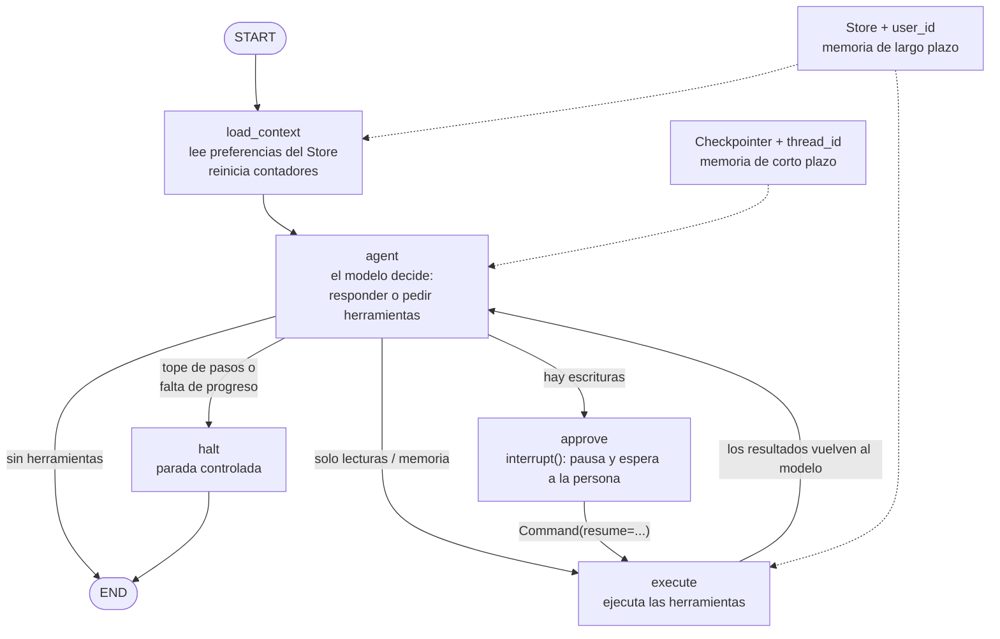
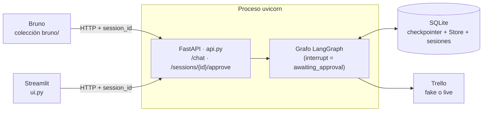

# langgraph-trello-ops-agent

Un **agente de operaciones** que gestiona **Trello** (tableros, listas y tarjetas), construido **a mano con `StateGraph`** de LangGraph, no con `create_agent`. Reúne en un solo proyecto lo que se ve en la sesión 11:

- **Lecturas** (listar tableros y listas, ver y buscar tarjetas) y **escrituras** (crear tarjeta, moverla, comentarla).
- **Aprobación humana** (`interrupt`) antes de **cualquier** escritura.
- **RAG** sobre un runbook ficticio ([`data/runbook_operaciones.md`](data/runbook_operaciones.md)) para decidir qué hacer y dónde.
- **Memoria de corto plazo** (checkpointer + `thread_id`) y **de largo plazo** (Store: preferencias del usuario, por ejemplo su tablero por defecto).
- **Tope de pasos**, detección de **falta de progreso** y `recursion_limit` como red de seguridad.
- **Expuesto como servicio:** una **API FastAPI** (`api.py`) con sesiones persistentes (`session_id` = `thread_id`) y aprobación por HTTP, una **interfaz Streamlit** sencilla (`ui.py`) y una **colección Bruno** (`bruno/`) que recorre todo paso a paso.
- **Opcional (apagado por defecto):** herramientas **MCP** (S10) con `langchain-mcp-adapters` (`USE_MCP=1`).

Trello es un sistema **externo real** con API gratuita; este proyecto **no se parece en dominio** al CRM de la sesión 10: aquí es gestión de trabajo. Por defecto corre **100 % simulado** (`TRELLO_MODE=fake`, modelo falso y embeddings falsos): sin cuenta, sin llaves y sin costo.

## El grafo



Y el agente como servicio (`api.py`): el cliente solo lleva el `session_id`; el estado vive en el checkpointer SQLite.



`execute` **solo escribe en Trello si hay una aprobación en el estado**: aunque algo saltara el nodo `approve`, la escritura se rechaza (defensa en profundidad).

## Las piezas

| Archivo | Qué hace | Concepto de LangGraph |
| --- | --- | --- |
| [`trello_ops/state.py`](trello_ops/state.py) | `OpsState` (mensajes, pasos, aprobación, preferencias, bitácora) y `Context` (usuario) | `TypedDict`, **reducers** (`add_messages`, `operator.add`), `context_schema` |
| [`trello_ops/nodes.py`](trello_ops/nodes.py) | Los nodos `load_context`, `agent`, `approve`, `execute`, `halt` y la arista condicional | Nodos, aristas condicionales, `interrupt()`, `Runtime` (store y contexto) |
| [`trello_ops/tools.py`](trello_ops/tools.py) | Las 9 herramientas, clasificadas en lectura, escritura y memoria | Herramientas; el modelo **pide**, el nodo **ejecuta** |
| [`trello_ops/graph.py`](trello_ops/graph.py) | Ensambla y compila el grafo | `StateGraph`, `add_edge`, `add_conditional_edges`, `compile(checkpointer, store)` |
| [`trello_ops/trello_client.py`](trello_ops/trello_client.py) | `FakeTrello` (en memoria) y `LiveTrello` (API REST con guardas) | (no es LangGraph: es el sistema externo) |
| [`trello_ops/retriever.py`](trello_ops/retriever.py) | Mini-RAG en memoria sobre el runbook (copia mínima del de `langchain-agentic-rag`) | (no es LangGraph) |
| [`trello_ops/model.py`](trello_ops/model.py), [`fake_model.py`](trello_ops/fake_model.py) | `build_model()` según `LLM_PROVIDER`; un modelo falso con reglas | `init_chat_model` |
| [`trello_ops/persistence.py`](trello_ops/persistence.py) | Checkpointer y Store en RAM o en SQLite | `InMemorySaver`/`SqliteSaver`, `InMemoryStore`/`SqliteStore` |
| [`trello_ops/runner.py`](trello_ops/runner.py) | Invocar, detectar la pausa, preguntar y reanudar | `stream(stream_mode="updates")`, `Command(resume=...)` |
| [`trello_ops/mcp_tools.py`](trello_ops/mcp_tools.py) | Herramientas MCP opcionales (`USE_MCP=1`) | `langchain-mcp-adapters` |
| [`trello_ops/studio.py`](trello_ops/studio.py) + [`langgraph.json`](langgraph.json) | Entrada para el servidor de desarrollo | `langgraph dev`, Studio |
| [`api.py`](api.py) | API FastAPI: `/chat`, sesiones, historial, `approve`, `health`; modelos Pydantic y errores HTTP | `thread_id` = `session_id`, `get_state`, `Command(resume=...)`, `delete_thread` |
| [`ui.py`](ui.py) | Chat Streamlit que consume la API por HTTP, con botones Aprobar/Rechazar | (no es LangGraph: es un cliente más) |
| [`bruno/`](bruno) | Colección Bruno de 14 peticiones con aserciones y pruebas | (cliente HTTP) |
| [`main.py`](main.py) | Línea de comandos: mensaje único, `--trace`, `--chat`, `--db` | `thread_id`, `Context(user_id)` |
| [`tests/`](tests) | 45 pruebas **sin red** (grafo, cliente de Trello, MCP, API con `TestClient`, interfaz con `AppTest`) | modelo guionado + `FakeTrello` |

## Cómo correrlo

```bash
cd langgraph-trello-ops-agent
cp .env.example .env            # opcional: sin .env todo corre simulado
uv sync
uv run python main.py --trace "Muestra mis tableros"
uv run python main.py --trace 'Crea una tarjeta "Revisar alertas de disco"'     # pausa y pregunta: [s/n]
uv run python main.py --trace 'Mueve la tarjeta "Revisar respaldo semanal" a "Hecho"'
uv run python main.py --chat --trace --db .data/ops.sqlite      # memoria que sobrevive a cerrar el programa
uv run pytest -q                                                # pruebas sin red
uv run langgraph dev                                            # servidor de desarrollo + Studio (puerto 2024)
```

> **Ojo con tu `.env`:** `load_dotenv(find_dotenv())` busca un `.env` también en las carpetas superiores. Si en la raíz del repositorio tienes `LLM_PROVIDER=openai`, el agente usará ese modelo (de pago) aunque aquí no tengas `.env`. Para forzar la simulación: `LLM_PROVIDER=fake uv run python main.py ...`.

### Frases que entiende el modelo falso

Es un conjunto de reglas, **no** un modelo de lenguaje; sirve para ver el grafo sin llaves. Con un modelo real (`LLM_PROVIDER=openai|anthropic|local`) el mismo grafo entiende lenguaje natural.

| Frase | Qué hace |
| --- | --- |
| `Muestra mis tableros` | `list_boards` |
| `Mi tablero por defecto es "Operaciones TI"` | `remember_preference` (Store) |
| `Muéstrame las tarjetas` | `list_cards` del tablero por defecto |
| `Busca "certificado"` | `search_cards` |
| `Crea una tarjeta "Título"` (opcional: `en "Lista"`) | `search_runbook` → `list_lists` → `create_card` (con aprobación) |
| `Mueve la tarjeta "Título" a "Lista"` | `search_runbook` → `search_cards` → `list_lists` → `move_card` (con aprobación) |
| `Comenta en "Título" "texto"` | `search_cards` → `add_comment` (con aprobación) |

### Aprobar desde código (sin terminal)

`graph.invoke(...)` devuelve la clave `__interrupt__` cuando el grafo se pausa; se reanuda con `Command(resume=...)` y el **mismo `thread_id`**. Acepta `True`/`False` o `{"approved": bool, "reason": "..."}`. `--approve yes|no` en la línea de comandos decide sin preguntar (solo para demostraciones y pruebas; sin terminal interactiva y sin ese flag, las escrituras se **rechazan**).

## Servir el agente: API, sesiones, interfaz y Bruno

El agente es **un servicio sin estado en el proceso**: el estado vive en el checkpointer (SQLite) y el cliente solo lleva el **`session_id`**, que es el `thread_id` de LangGraph. Reinicias la API y la misma sesión continúa; incluso una aprobación pendiente sobrevive.

```bash
uv run uvicorn api:app --port 8011            # o: task api · documentación interactiva en http://127.0.0.1:8011/docs
API_URL=http://127.0.0.1:8011 uv run streamlit run ui.py --server.port 8511     # o: task ui
cd bruno && npx --yes @usebruno/cli@4.3.0 run --env local                        # o: task bruno
```

Variables: `OPS_DB` (archivo SQLite; por defecto `.data/ops.sqlite`) y, como siempre, `LLM_PROVIDER`, `TRELLO_MODE`... Con las predeterminadas todo es simulado. **Aviso:** el Trello simulado vive en memoria y **se reinicia con la API**; las sesiones, no.

| Endpoint | Qué hace | Errores |
| --- | --- | --- |
| `GET /health` | Estado, proveedor de modelo, modo de Trello, si las sesiones sobreviven al reinicio | `status: degraded` si falló el arranque |
| `POST /chat` | `{"message", "session_id"?, "user_id"?}`. Crea la sesión si no envías `session_id` y **lo devuelve**. Responde `status` (`completed` · `awaiting_approval` · `halted`), `answer`, `pending_actions`, `tools_used`, `writes`, `usage` | 422 validación · 403 sesión de otro usuario · 409 sesión esperando aprobación · 503 sin agente |
| `POST /sessions/{id}/approve` | `{"approved": true\|false, "reason"?}`: reanuda el grafo con `Command(resume=...)` | 404 · 409 si no hay nada pendiente |
| `GET /sessions/{id}` | Historial legible (`human`, `ai`, `tool`) y `status` | 404 |
| `GET /sessions?user_id=` | Sesiones registradas (de un usuario) | |
| `DELETE /sessions/{id}` | Borra el hilo del checkpointer | 404 |

```bash
curl -s localhost:8011/chat -H 'content-type: application/json' \
  -d '{"message": "Crea una tarjeta \"Revisar alertas de disco\"", "user_id": "ana"}'
# → {"session_id": "…", "status": "awaiting_approval", "pending_actions": [{"tool": "create_card", "args": {…}, "summary": "Crear la tarjeta …"}], …}
curl -s localhost:8011/sessions/<session_id>/approve -H 'content-type: application/json' -d '{"approved": true}'
# → {"status": "completed", "answer": "Hecho. Tarjeta creada: …", "writes": [{"tool": "create_card", "status": "ok"}], …}
curl -s localhost:8011/chat -H 'content-type: application/json' -d '{"message": "¿qué tarjetas hay?", "session_id": "<session_id>", "user_id": "ana"}'   # misma conversación
```

`usage` suma los tokens que reporta el modelo (con el modelo falso son 0) y `model_calls` es el número de llamadas al modelo de esa pregunta.

**La aprobación por API.** Cuando el grafo se pausa con `interrupt()`, `POST /chat` responde `awaiting_approval` con la acción propuesta; la API no devuelve texto hasta que alguien llame a `POST /sessions/{id}/approve`. Mientras tanto, otro `POST /chat` en esa sesión devuelve 409.

**Interfaz Streamlit (`ui.py`).** Chat sencillo (`st.chat_message`, `st.chat_input`) que habla con la API por HTTP: barra lateral con el usuario, el botón **Nueva sesión** y el `session_id` visible; debajo de cada respuesta, herramientas, llamadas al modelo y tokens; y, cuando hay una pausa, la acción propuesta con **Aprobar / Rechazar**.

**Colección Bruno (`bruno/`).** Abre la **carpeta `bruno/`** con *Open Collection* en Bruno y elige el ambiente `local` (`baseUrl`, `user_id`). Las 14 peticiones cuentan una historia: salud → chat nuevo (un script guarda `session_id`) → seguimiento con `{{session_id}}` → historial → otra sesión (no ve la anterior, pero recuerda las preferencias del usuario) → escritura que queda en `awaiting_approval` → aprobar → otra escritura → rechazar → 404 → borrar sesiones. Cada petición lleva aserciones y pruebas. Por línea de comandos: `cd bruno && npx --yes @usebruno/cli@4.3.0 run --env local` (con la API en otro puerto: `--env-var baseUrl=http://127.0.0.1:PUERTO`).

**FastAPI propio o LangGraph Server (`langgraph dev`).** Este proyecto trae **ambos** caminos a propósito:

| | FastAPI propio (`api.py`) | LangGraph Server (`langgraph dev`, Agent Server) |
| --- | --- | --- |
| Contrato HTTP | El tuyo (`session_id`, `status`, modelos Pydantic) | El del servidor: asistentes, hilos (`threads`), ejecuciones (`runs`), `store`, streaming; su referencia está en `/docs` |
| Persistencia | La eliges tú (aquí, SQLite) | La aporta el servidor (en `langgraph dev`, en memoria) |
| Autenticación, límites, middleware | Los pones tú | Los del servidor (y rutas propias con `http.app` en `langgraph.json`) |
| Studio | No | Sí (se conecta al servidor) |
| Cuándo | Una API pequeña con contrato propio, integrada a tu infraestructura | Quieres hilos, ejecuciones en segundo plano, *streaming*, crons y Studio sin escribirlos; o un despliegue gestionado |

Verificado: `langgraph dev` sirve el grafo en el puerto 2024 y ejecutó una corrida con pausa de aprobación por su API REST (ver abajo); la documentación indica que el servidor acepta rutas FastAPI propias con `http.app` y que el despliegue gestionado se hace con `langgraph deploy` (LangSmith, plan de pago). **No verificado aquí:** el autoalojamiento del servidor (imagen propia, requisitos de base de datos y licencia): consulta la documentación de LangSmith antes de decidir.

## Estructura de proyecto y `langgraph dev`

`langgraph.json` registra el grafo (`trello_ops`) para el servidor de desarrollo de LangGraph; el servidor aporta su propio checkpointer y store, por eso `studio.py` compila **sin** ellos.

```bash
uv run langgraph dev            # http://127.0.0.1:2024 · Studio: https://smith.langchain.com/studio/?baseUrl=http://127.0.0.1:2024
```

Studio es una interfaz alojada que se conecta a tu servidor local (puede pedir cuenta gratuita de LangSmith). El servidor en sí funciona sin ella: se verificó creando un hilo y ejecutando el grafo por su API REST, que devolvió la pausa de aprobación.

## Trello real (`TRELLO_MODE=live`)

1. **Clave:** en <https://trello.com/power-ups/admin> crea un Power-Up y, en la pestaña *API key*, genera la clave.
2. **Token:** abre `https://trello.com/1/authorize?expiration=1day&scope=read,write&response_type=token&key=TU_CLAVE`, pulsa *Allow* y copia el token. Caduca en un día (`expiration`); usa una **cuenta y un tablero de prueba**.
3. En `.env`: `TRELLO_MODE=live`, `TRELLO_API_KEY`, `TRELLO_TOKEN` y `TRELLO_WRITE_BOARDS=<id del tablero de prueba>`. El id aparece en `list_boards`.

Autenticación (documentación oficial): clave y token por parámetros de consulta, por la cabecera `Authorization: OAuth oauth_consumer_key="...", oauth_token="..."` o en el cuerpo. Este proyecto usa la **cabecera**, para que las credenciales no queden en la URL.

| Herramienta | Ruta de la API (base `https://api.trello.com/1`) |
| --- | --- |
| `list_boards` | `GET /members/me/boards` |
| `list_lists` | `GET /boards/{id}/lists` |
| `list_cards` | `GET /boards/{id}/cards` |
| `search_cards` | `GET /search?modelTypes=cards` |
| `create_card` | `POST /cards` (`idList`, `name`, `desc`) |
| `move_card` | `PUT /cards/{id}` (`idList`) |
| `add_comment` | `POST /cards/{id}/actions/comments` (`text`) |

**Protecciones de las escrituras** (además de la aprobación humana): lista de tableros permitidos (`TRELLO_WRITE_BOARDS`; vacía = **bloqueadas**), `TRELLO_DRY_RUN=1` (valida y no escribe), solo se mueve entre listas del mismo tablero, **no existe** herramienta para borrar o archivar, límite de 25 líneas por resultado, reintentos solo ante 429/5xx, tiempo límite por llamada, errores sin credenciales, y una **bitácora** (`audit` en el estado) con cada herramienta ejecutada, rechazada o fallida.

> **Qué NO se probó:** el modo `live` **no se ejecutó contra Trello real** (no había claves). Sí se verificó con pruebas que usan una sesión HTTP falsa: rutas, cabecera de autenticación, parámetros, guardas, dry-run y reintentos. Las rutas y parámetros se contrastaron con el OpenAPI oficial (`swagger.v3.json`). Dos detalles quedan por confirmar en vivo: que `members/me` sea aceptado como id (es la forma habitual, pero el OpenAPI solo declara `id`) y que `card_list=true` en `/search` devuelva el nombre de la lista (si no, el campo `lista` queda vacío).

## MCP opcional (`USE_MCP=1`)

```bash
uv sync --group mcp
# mcp_servers.json:  {"demo": {"transport": "stdio", "command": "python", "args": ["tests/mcp_demo_server.py"]}}
USE_MCP=1 MCP_SERVERS_FILE=mcp_servers.json MCP_READONLY_TOOLS=status_page uv run python main.py --trace "..."
```

Las herramientas del servidor se suman a las del agente. **Por defecto toda herramienta MCP se trata como escritura** (pasa por `approve`); solo las que declares en `MCP_READONLY_TOOLS` se ejecutan sin aprobación (mínimo privilegio). Probado con un servidor MCP local por stdio (`tests/mcp_demo_server.py`), sin red. En Docker: `docker compose build --build-arg WITH_MCP=1`.

## Con Taskfile

```bash
task install
task trace -- 'Crea una tarjeta "Revisar alertas de disco"'
task chat            # conversación con memoria persistente en .data/ops.sqlite
task api             # API FastAPI en :8011
task ui              # interfaz Streamlit en :8511
task bruno           # colección Bruno con su CLI
task dev             # langgraph dev
task test
```

## Con Docker

`docker compose up --build` levanta la **API** (`http://localhost:8011/docs`) y la **interfaz** (`http://localhost:8511`), ambas con *healthcheck*; la interfaz espera a que la API esté sana. Lee tu `.env` (de esta carpeta o de la raíz) y guarda las sesiones en el volumen `ops-data`. El agente de línea de comandos es un servicio aparte de un solo uso (perfil `cli`).

```bash
task docker:up                                    # o: docker compose up --build   (puertos: API_PORT y UI_PORT)
task docker:ask -- 'Crea una tarjeta "Revisar alertas de disco"'     # CLI en un contenedor: pregunta [s/n] en la terminal
task docker:chat
docker compose down -v                            # borra también las sesiones
```

> Si tu `.env` de la raíz define `LLM_PROVIDER=openai`, los contenedores lo usarán: para simular, pon `LLM_PROVIDER=fake` en un `.env` de esta carpeta. Con LM Studio, `task docker:ask:host` (solo Linux).

## Qué mirar con `--trace`

- `▶ nodo`: el recorrido del grafo (`load_context → agent → execute → agent → approve → execute → agent`).
- `🤖` lo que **pidió** el modelo y `🔧` lo que devolvió tu código. El modelo nunca ejecuta nada.
- Pide **escribir** y verás la pausa `⏸️`: nada cambia hasta que respondes. Responde `n` y observa cómo el modelo recibe el rechazo y no insiste.
- Dile `Mi tablero por defecto es "Migración a la nube"`, abre **otra** conversación (otro `--thread`, mismo `--user`, mismo `--db`) y pide `Muéstrame las tarjetas`: la preferencia sobrevive a los hilos.

## Experimentos sugeridos

1. Baja `MAX_STEPS` a 2 y pide crear una tarjeta: observa el nodo `halt` y la bitácora.
2. En `nodes.py`, quita la regla `REPEAT_LIMIT` y usa un guion que repita la misma búsqueda; compara con `recursion_limit`.
3. Haz que `approve` acepte **editar** los argumentos (`{"approved": true, "edits": {...}}`).
4. Agrega la herramienta `list_cards_due_soon` (lectura) y la herramienta `archive_card` (escritura): ¿qué cambia en el grafo? ¿y en las protecciones?
5. Mueve el grafo de `approve` + `execute` a un **subgrafo** de escrituras.
6. Usa `get_state_history` para volver a un punto anterior de un hilo y bifurcarlo.

## Versiones probadas

`langgraph 1.2.22`, `langgraph-checkpoint 4.3.2`, `langgraph-checkpoint-sqlite 3.1.3`, `langchain 1.5.0`, `langchain-core 1.8.0`, `langchain-openai 1.8.0`, `langchain-anthropic 1.7.10`, `fastapi 0.163.0`, `uvicorn 0.54.0`, `streamlit 1.67.0`, `httpx 0.28.1`, `langgraph-cli 0.4.43`, `langchain-mcp-adapters 0.3.2` (grupo `mcp`), `pydantic 2.14.3`, `pytest 9.2.0`, CLI de Bruno `@usebruno/cli 4.3.0` (Node v20.10.0) (resueltas con `uv sync` en noviembre de 2026; versiones exactas en `uv.lock`). Python 3.12.

**Probado:** 45 pruebas sin red (aprobación aceptada y rechazada, tope de pasos, falta de progreso, `recursion_limit`, persistencia del hilo entre ejecuciones y reinicios, aprobación pendiente que sobrevive al reinicio, memoria de largo plazo, cliente de Trello con sesión falsa, MCP con un servidor local); el servidor `langgraph dev` por su API REST; la imagen Docker (API y UI **healthy** con `docker compose up`, colección Bruno 14/14 contra el contenedor, reinicio de la API con sesión y aprobación pendiente intactas); la **API** en vivo con uvicorn (reinicio del proceso y continuación de la misma sesión, incluida una aprobación pendiente); la **colección Bruno** de punta a punta con el CLI (14 peticiones, 9 pruebas, 22 aserciones); la **interfaz Streamlit** con `AppTest` y arrancada de verdad (`/_stcore/health` responde `ok`); y el agente completo con **OpenAI `gpt-6-luna`** contra Trello simulado (crear y mover una tarjeta, con dos aprobaciones). **No se probó:** Trello real, Anthropic, LM Studio, el Studio alojado (interfaz web), la aplicación de escritorio de Bruno (solo su CLI; el formato `.bru` se validó porque el CLI lo ejecuta), la interfaz Streamlit en un navegador real (solo `AppTest` y el chequeo de salud) y el autoalojamiento de LangGraph Server.

## 💰 Costo

Por defecto, US$ 0 (modelo, embeddings y Trello simulados). Con un modelo de pago, una petición típica hace de 4 a 8 llamadas al modelo (centavos o menos con un modelo económico); `MAX_STEPS` limita las llamadas por pregunta. La API de Trello es gratuita (con límites de tasa).
