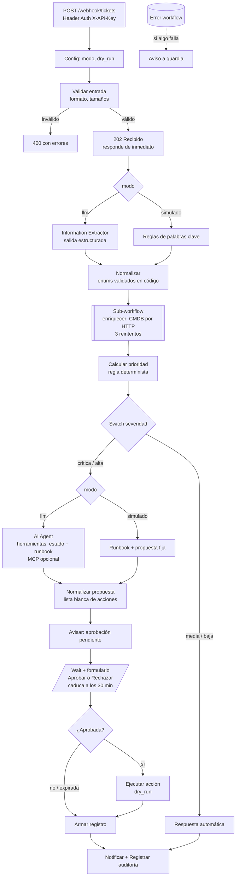

# n8n-workflows

Laboratorio de la **Sesión 12 · n8n**: n8n local con Docker y siete workflows importables con la CLI:

1. un **agente de chat** sencillo (Chat Trigger → AI Agent con memoria y dos herramientas), y
2. un **triaje de tickets de TI** que no es básico: webhook autenticado → clasificación estructurada → enriquecimiento con un sub-workflow → *switch* por severidad → agente con herramientas que **propone** → **aprobación humana** → acción en `dry-run` → notificación y auditoría, con un **error workflow**.

> Todo lo que parece un sistema externo (CMDB, chat, bitácora) es **simulado dentro del propio n8n**, y todos los datos son ficticios. El flujo corre completo **sin llaves ni modelo** (`modo = simulado`). Con un modelo (OpenAI, Anthropic o LM Studio) basta cambiar `modo` a `llm`.

## Arquitectura del triaje



**Idea de diseño:** el agente **no tiene herramientas de escritura**. Solo propone. La acción la ejecuta el *flujo* (determinista) y únicamente después de una decisión humana, en `dry_run`, con tipo de acción dentro de una lista blanca verificada en código y con auditoría.

## Piezas

| Archivo (`workflows/`) | Qué es | Muestra | ¿Necesita LLM? |
| --- | --- | --- | --- |
| `01-agente-chat.json` | Chat Trigger → AI Agent + Simple Memory + `estado_servicio` (Code Tool) + `buscar_runbook` (workflow como herramienta) + MCP Client Tool (desactivado) + modelo alterno Anthropic (sin conectar) | Agente: modelo, memoria, herramientas | Sí |
| `02-triaje-tickets.json` | El flujo principal (34 nodos más 5 notas adhesivas) | Webhook autenticado, Information Extractor, Execute Workflow, Switch, AI Agent con parser estructurado, Wait con formulario y caducidad, reintentos, error workflow | No en `simulado`; sí en `llm` |
| `03-sub-enriquecer-ticket.json` | Sub-workflow: consulta la CMDB (HTTP con 3 reintentos) | Sub-workflows, reintentos | No |
| `04-sub-buscar-runbook.json` | Sub-workflow que busca runbooks; es también la herramienta `buscar_runbook` del agente | Workflow como herramienta | No |
| `05-error-workflow.json` | Error Trigger → arma aviso → bitácora | Error workflow | No |
| `06-servicios-simulados.json` | CMDB ficticia y bitácora (`sim-registro`) con webhooks locales | "Sistemas externos" sin cuentas | No |
| `07-servidor-mcp.json` | **MCP Server Trigger** que expone las mismas dos herramientas en `/mcp/s12-mcp` (Header Auth) | n8n como servidor MCP | No |

| Otros archivos | Para qué |
| --- | --- |
| `docker-compose.yml` | n8n **2.47.7** (versión fijada), solo en `127.0.0.1:5678`, volumen para los datos |
| `docker-compose.host.yml` | Linux: red del anfitrión para alcanzar LM Studio en `localhost` |
| `.env.example` | `N8N_ENCRYPTION_KEY`, `N8N_WEBHOOK_TOKEN` y llaves opcionales de modelo |
| `scripts/seed_credentials.py` | Crea las credenciales dentro de n8n con la CLI, leyendo `.env` (no imprime llaves) |
| `scripts/import_workflows.sh` | Importa y publica los workflows y reinicia n8n |
| `scripts/n8n_client.py` | Cliente en Python (`requests`): `send`, `approve`, `log`, `clear` |
| `scripts/trigger_ticket.sh` | Lo mismo que `send`, con `curl` |
| `scripts/fake_openai.py` | Servidor falso compatible con OpenAI, para probar el modo `llm` **sin modelo real** |
| `data/tickets/*.json` | Siete tickets ficticios, uno por ruta del flujo |
| `tests/` | `pytest` sin red (estructura, sin secretos, lista blanca) y pruebas de integración opcionales |

> No hay `Dockerfile` ni `model.py`: aquí no se construye imagen (n8n ya es la imagen) y el modelo se elige en una **credencial** de n8n y en el nodo `Config`, no en código.

## Inicio rápido (modo simulado, sin llaves)

Requisitos: Docker con `docker compose`, y `uv` (o Python 3.12 con `requests`) para los scripts. [Task](https://taskfile.dev) es opcional.

```bash
cd ai-agents-playground/n8n-workflows
cp .env.example .env            # cambia N8N_ENCRYPTION_KEY y N8N_WEBHOOK_TOKEN por valores propios y largos
docker compose up -d            # o: task up
uv sync
uv run python scripts/seed_credentials.py     # crea las credenciales S12 en n8n
sh scripts/import_workflows.sh                # importa, publica y reinicia
```

Abre <http://localhost:5678>. La primera vez n8n pide crear la cuenta del **propietario** (correo y contraseña locales; tú los eliges). Los workflows ya estarán en la lista, con el prefijo `S12 ·`.

> Si cambias `N8N_ENCRYPTION_KEY` **después** de crear credenciales, n8n ya no puede descifrarlas: borra el volumen (`docker compose down -v`) o vuelve a ejecutar `seed_credentials.py`. En la práctica, esa clave se respalda junto con la base.

### Probar el triaje

```bash
uv run python scripts/n8n_client.py send data/tickets/01_critico_vpn.json   # responde 202
uv run python scripts/n8n_client.py log                                      # ve la notificación de aprobación pendiente
uv run python scripts/n8n_client.py approve TCK-1001 --aprobador OL          # o abre la url_aprobacion del log en el navegador
uv run python scripts/n8n_client.py log                                      # acción en dry-run, notificación final y auditoría
```

Con `curl` (el token sale de `.env` y no se imprime):

```bash
sh scripts/trigger_ticket.sh data/tickets/01_critico_vpn.json
```

| Ticket | Qué demuestra | Resultado esperado (modo simulado) |
| --- | --- | --- |
| `01_critico_vpn` | Severidad crítica, activo crítico, agente y aprobación | Espera aprobación; tras `Aprobar`: `ejecutada_dry_run` |
| `02_alto_correo` | Severidad alta; se rechaza | `Rechazar` → `rechazada`, **no** hay acción |
| `03_media_wiki_lenta` | Rama media/baja | `resuelto_automatico`, sin aprobación |
| `04_bajo_contrasena` | Rama baja, sin host | `resuelto_automatico` |
| `05_inyeccion` | Texto del ticket con instrucciones maliciosas | La propuesta sigue siendo `reiniciar_servicio` sobre `erp-app-01`; nada de "todos los servidores" |
| `06_falla_cmdb` | Reintentos y error workflow | 3 intentos fallidos → entrada `error` en la bitácora |
| `07_invalido` | Validación | `400` con la lista de errores |

También: sin la cabecera `X-API-Key` (o con una incorrecta) el webhook responde `403`.

### Pasar a un modelo real (`modo = llm`)

1. En **Credentials** de n8n, edita `S12 OpenAI (o LM Studio)`: pon tu llave (OpenAI) o, para LM Studio, una llave cualquiera y la URL `http://host.docker.internal:1235/v1` (o `http://localhost:1235/v1` con `docker-compose.host.yml`). Modelo por defecto en los nodos: `gpt-6-luna`; con LM Studio escribe el nombre de tu modelo (uno de ≈ 12B o más). Para Anthropic, crea la credencial `S12 Anthropic` y conecta el nodo *Anthropic Chat Model* del workflow 01 (modelo `claude-haiku-5-5`).
2. En el workflow 02, abre el nodo **Config** y cambia `modo` a `llm`.
3. Repite el envío de tickets.

**Costo orientativo:** `modo = simulado` es **US$ 0**. Con `llm`, cada ticket hace 1 llamada de clasificación y, si es alto o crítico, un agente de unas 3 a 5 llamadas; con los modelos económicos del curso es del orden de centavos o menos por ticket (confirma los precios vigentes). El chat del workflow 01 hace de 2 a 4 llamadas por mensaje. Con LM Studio es gratis.

### Probar el modo `llm` sin gastar: el modelo falso

```bash
uv run python scripts/fake_openai.py --verbose      # escucha en 0.0.0.0:8765 (solo para pruebas locales)
OPENAI_BASE_URL=http://host.docker.internal:8765/v1 OPENAI_API_KEY=fake uv run python scripts/seed_credentials.py
```

Luego cambia `modo` a `llm`. Sirve para ver el cableado (credencial, herramientas, sub-workflow como herramienta, parser de salida), **no** para evaluar calidad. Al terminar, vuelve a ejecutar `seed_credentials.py` sin esas variables.

### Servidor MCP de n8n (opcional)

El workflow 07 expone `estado_servicio` y `buscar_runbook` en `http://localhost:5678/mcp/s12-mcp` con Header Auth (`X-API-Key`). Para usarlo desde el agente, activa el nodo **MCP Client Tool** (apunta a esa URL; añade la credencial de cabecera si activas la autenticación). Para conectar con el **servidor MCP de la Sesión 10** (HTTP), cambia la URL del nodo a `http://host.docker.internal:<puerto>/mcp` (el que use ese proyecto) y su autenticación. Eso depende de tu servidor y es opcional.

## Qué se probó y qué no

Probado en este equipo (Linux, Docker 29, n8n **2.47.7**, noviembre de 2026):

- Arranque limpio (`down -v` + `up`), creación de credenciales, **importación por CLI** de los 7 workflows y publicación: cargan sin errores y todos los tipos de nodo y versiones existen en esa imagen.
- Triaje completo en `simulado`: los 7 tickets, `403` sin/ con llave incorrecta, `400` por validación, aprobación por formulario (`Aprobar` y `Rechazar`), caducidad de la aprobación (con la espera acortada a 8 s en una copia de prueba: queda `expirada` y no ejecuta), reintentos y error workflow, y la bitácora. Siete pruebas de integración pasan (`uv run pytest -m integration`).
- Modo `llm` **con el modelo falso** (no un modelo real): Information Extractor, AI Agent con las dos herramientas (Code Tool y workflow como herramienta) y parser de salida estructurada, hasta la aprobación pendiente; y el chat del workflow 01 con memoria (en una copia con el Chat Trigger público, por `curl`).
- Servidor MCP del workflow 07 con `curl`: `initialize`, `tools/list` y autenticación (`403` sin llave).
- `uv run pytest`: 39 pruebas sin red.

**NO probado:**

- Ninguna ejecución con un **modelo real** (OpenAI, Anthropic o LM Studio): no había llaves. Por eso la calidad de la clasificación, la elección de herramientas y la salida estructurada con un modelo real no están verificadas; el prompt y el esquema son un punto de partida.
- El nodo **MCP Client Tool** conectado a un servidor (viene desactivado), y la conexión con el servidor MCP de la Sesión 10.
- La credencial y el nodo de Anthropic.
- Los ajustes de producción (cola de ejecución, TLS, SSO, `N8N_BLOCK_ENV_ACCESS_IN_NODE`, SSRF): se describen en el marco teórico, no están configurados aquí.

## Seguridad en este laboratorio (y lo que falta en producción)

- Los workflows exportados **no llevan credenciales**: solo la referencia (`id` y nombre). Los valores se crean con `seed_credentials.py` desde `.env`, que no se versiona.
- n8n escucha solo en `127.0.0.1`. Los webhooks de simulación (`sim-*`) **no tienen autenticación**: solo para localhost.
- Webhook de tickets con *Header Auth*; el token se compara en n8n. En producción: HTTPS (proxy inverso), token largo y rotado, límite de tasa y lista de IP si aplica.
- Cifrado: las credenciales van cifradas en la base con `N8N_ENCRYPTION_KEY`; respáldala aparte.
- Lista blanca de acciones verificada en código, aprobación humana, `dry_run`, caducidad, límites de tamaño y de iteraciones del agente, auditoría.
- Revisa el estado de seguridad de la instancia: `docker compose exec n8n n8n audit`.

## Versiones

n8n `2.47.7` (imagen `n8nio/n8n:2.47.7`; etiqueta `stable` en Docker Hub el 13 de nov de 2026 apuntaba a ese mismo resumen; hay una serie 3.x en beta). Scripts: Python 3.12, `requests`, `pytest`.
